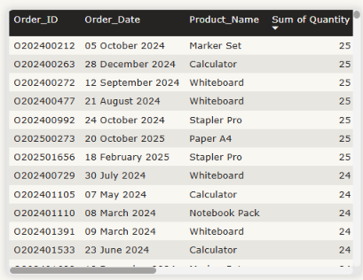

# B2B Sales Performance Dashboard – Power BI

Interactive Power BI dashboard built as part of a Data Analytics practical assessment.  
The report analyzes sales performance, profitability, returns, and target achievement for a B2B business.

---

## 📊 Dashboard Overview

The report contains the following pages:

- **Executive Overview** – High-level KPIs, Sales Trend, Sales vs Target by Region, and Profit by Category

- **Performance Analysis** – Top/Bottom 5 Products, Salesperson Performance, and Customer Segment analysis

- **Customer / Order Details** – Drill-through page for detailed customer and order-level exploration

---

## 🛠️ Key Features

- Data cleaning and transformation using Power Query
- Star schema data model with a dedicated Calendar table
- 12+ DAX measures including:
  - Total Net Sales, Total Profit, Profit Margin %
  - Valid Orders, Average Order Value
  - Return Rate %, Return Value, Adjusted Sales
  - Target Achievement %, Sales YTD, Sales YoY %
- Interactive visuals with slicers (Year, Region, Category, Channel)
- Drill-through functionality for customer/order details
- Dynamic Top/Bottom N analysis

---

## 📁 Repository Structure
├── B2B Sales Dashboard.pbit          # Power BI Template file
├── Documentation/
│   ├── Assumptions & Business Rules.md
│   ├── Business_Insights.md
│   └── Data_Dictionary_Notes.md
├── Screenshots/                      # Dashboard page screenshots
├── .gitignore
└── README.md
text---

## 📌 Business Insights

Key insights derived from the dashboard are documented in:

→ [Business_Insights.md](Documentation/Business_Insights.md)

---

## ⚙️ Assumptions & Business Rules

Important data handling rules and assumptions are listed here:

→ [Assumptions & Business Rules.md](Documentation/Assumptions%20&%20Business%20Rules.md)

---

## 🚀 How to Use

1. Download the `B2B Sales Dashboard.pbit` file
2. Open it in **Power BI Desktop**
3. If prompted, reconnect the data source to the original Excel file
4. Refresh the report

---

## 🛠️ Tools Used

- Power BI Desktop
- Power Query
- DAX
- Excel (source data)

---